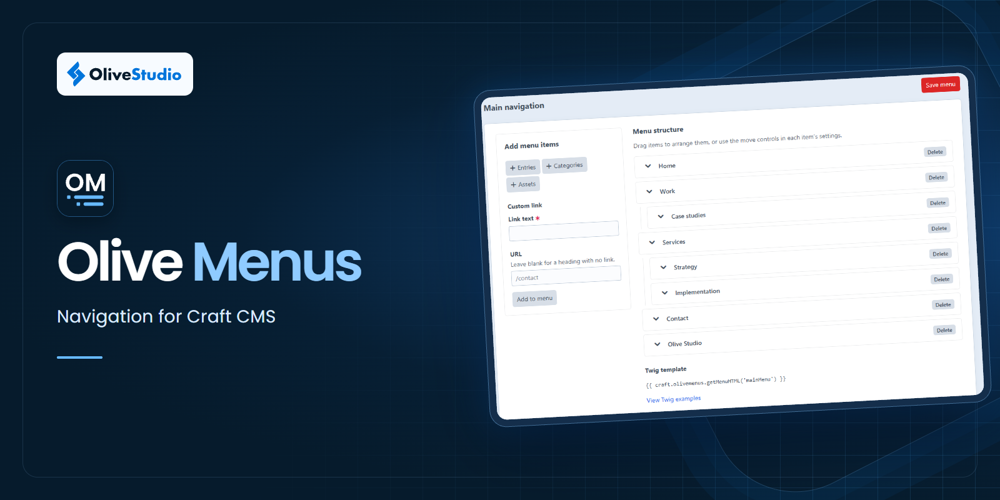

# Olive Menus for Craft CMS

Build navigation menus in the Craft control panel. Editors choose and arrange the links. Developers render the menu in Twig and style it to match the site.

- Create separate menus for a header, footer, or campaign page.
- Combine entries, categories, assets, and Commerce products with custom links and unlinked headings.
- Reorder and nest items, then edit labels, classes, link targets, and data attributes.
- Manage menus per site and copy their structure to another site you can edit.
- Build breadcrumbs in Twig or query navigation in GraphQL.

[Craft Plugin Store](https://plugins.craftcms.com/olivemenus) · [Documentation](https://github.com/OliveStudio/olivemenus/wiki) · [Changelog](CHANGELOG.md)


## Install

Olive Menus 5.x requires Craft CMS 5 and PHP 8.2 or later. Install it from the Plugin Store in Craft, or run these commands from your project directory.

```sh
composer require olivestudio/craft-olivemenus
php craft plugin/install olivemenus
```

## Render your first menu

1. Open **Olive Menus** in the control panel and choose **New menu**. Use `mainMenu` as the handle.
2. Open the menu, add entries or custom links, then choose **Save menu**.
3. Add this snippet to your layout where the navigation should appear.

```twig
<nav aria-label="Main navigation">
  {{ craft.olivemenus.getMenuHTML('mainMenu', { 'without-container': true }) }}
</nav>
```

For your own markup, use `craft.olivemenus.getMenuData('mainMenu')`. The [Twig guide](https://github.com/OliveStudio/olivemenus/wiki/06.-Insert-Twig-snippet) covers custom rendering, options, breadcrumbs, and multisite lookup. For headless builds, see the [GraphQL guide](https://github.com/OliveStudio/olivemenus/wiki/10.-GraphQL).

## Support and agency work

[Report a bug or suggest an improvement](https://github.com/OliveStudio/olivemenus/issues). Include your Craft and Olive Menus versions and the steps to reproduce the issue.

Working on a Craft build, upgrade, or integration for a client? [Talk to Olive Studio](https://www.olivestudio.net/) about working together.

[MIT license](LICENSE.md)
